# 👋 Welcome to the Living Synthesis vault

> [!info] One-line purpose
>
> **We have constructed a discourse graph of empirical evidence on automated technologies for research evaluation**built from peer-reviewed papers, organized so every claim is traceable to a paper passage and every screenshot grounds a verbatim quote.

---

## 🎯 Purposes

This vault supports a **systematic review on the use of automated technologies (especially large language models) for research evaluation** — peer review, evidence appraisal, error detection, citation integrity, and reporting-quality assessment.

Instead of one long literature-review document, the vault decomposes findings into atomic, linkable units called **discourse graph nodes**. Each node grounds itself in a verbatim quote and a screenshot from the source PDF, so claims survive without you needing to re-read the underlying papers.

> [!tip] Analogy
>
> A Wikipedia-of-evidence where every assertion is backed by a clickable, screenshotted quote and where questions, claims, evidence, and limitations are connected as an interactive graph.

---

## 🧱 Five node types

| Icon | Type                 | Prefix | Role                                       |
| :--: | -------------------- | ------ | ------------------------------------------ |
|  ❓   | **Question**         | `QUE`  | Research questions the field is asking     |
|  💡  | **Claim**            | `CLM`  | Generalizations that papers argue for      |
|  🔬  | **Evidence**         | `EVD`  | Atomic empirical observations from a paper |
| 🕸️  | **Evidence Pattern** | `EP`   | Empirical regularities across papers       |
|  ⚠️  | **Caveat**           | `CVT`  | Methodological limitations on evidence     |

> [!example] How they connect
>
> ```
> ❓ QUE: Can LLMs identify errors in scientific papers?
>     ↳ 💡 CLM: Reasoning LLMs outperform non-reasoning models at error detection.
>         ↳ 🔬 EVD: OpenAI o3 achieved 48.2% hit rate on PDF inputs.
>             ↳ ⚠️ CVT: Only closed-source reasoning LLMs were evaluated.
>
> 🕸️ EP: Reasoning LLMs lead other models at scientific-error and quality-checker benchmarks.
>     ↳ bundles 🔬 EVDs from Zhang Reviewing, Son SPOT, Lou AAAR, …
> ```
>
> EPs are the *cross-paper* layer: a single EP wires together ≥2 EVDs from independent papers that converge on the same regularity, even if no single paper makes the EP-level claim itself. EPs live in `sysrev/dgraph/evd-patterns/` and currently number 21.

---

## 🗺️ How to navigate

> [!tip] Six ways in
>
> 🟦 **Top-down (recommended for first-time readers).** Open [[DGRAPH]] — a single nested index of every QUE → CLM → EVD → CVT path in the vault. Every node is a clickable wikilink.
>
> 🟪 **Filter-by-property.** Open [[ESS - Demo]] — a live database with 22 pre-built views for slicing the corpus by node type, 5C research dimension, methodological rigor, severity, or workflow status. Best when you want "show me only EVDs from low-external-validity-risk papers" or similar property filters.
>
> 🟩 **Question-first.** Browse the `sysrev/dgraph/questions/` folder. Each QUE file lists its supporting CLMs with EVDs nested underneath.
>
> 🟨 **Paper-first.** Browse `sysrev/dgraph/source/pdfs/` (the original papers) or `sysrev/dgraph/source/@<citekey>.md` (the bibliographic stub). EVDs from a paper are filename-tagged with `@<citekey>` so a folder grep finds them. The [[DGRAPH-TABLE]] shows a paper × node-type matrix for skimming.
>
> 🕸️ **Pattern-first.** Browse `sysrev/dgraph/evd-patterns/` — the 21 cross-paper EvidencePatterns (EPs). Each EP names a regularity that ≥2 papers' EVDs jointly support, with a `## Supporting Evidence` block listing the constituent EVDs and a `## Connected discourse-graph nodes` block tying the pattern to the within-paper CLMs it generalizes. Best when you want the *thesis-level* takeaways across the corpus rather than per-paper findings.
>
> 🏆 **Leaderboard view.** Open [[Review-Arena]] — a head-to-head leaderboard of who wins at each subtask: AI alone, Human alone, or Human + AI. Each Subtask cell links back to its QUE for the full evidence base.

---

## 📁 File Locations

```
living-synthesis/
├── 👋  Welcome.md                  ← this file (the only file at the root)
├── 🔬  sysrev/                     ← the systematic-review content
│   ├── 🗺️  indexes/               ← dgraph.md (start here: central nested index), DGRAPH-TABLE.md, Review-Arena.md, ESS files
│   ├── 🧩  dgraph/                ← the discourse-graph nodes
│   │   ├── ❓  questions/             ← QUE notes
│   │   ├── 💡  claims/                ← CLM notes
│   │   ├── 🔬  evidence/              ← EVD notes + Attachments/ (all PNGs)
│   │   ├── ⚠️  caveats/               ← CVT notes
│   │   ├── 🕸️  evd-patterns/          ← EP notes (cross-paper regularities, ≥2 EVDs each)
│   │   └── 📚  source/                ← bibliographic notes + pdfs/
│   └── 🗃️  reference/             ← background notes and the paraphrase audit TSV
└── 🛠️  pipeline/                   ← how the review is built and published
    ├── 🛠️  skills/                ← Skill*.md (how new papers are extracted), Tools-and-Models.md
    ├── 📐  templates/             ← T - <NodeType> templates
    ├── ⚙️  scripts/               ← reproducible helper scripts
    ├── 📜  logs/                  ← History.md (chronological log of vault changes), Log.md
    ├── ⚖️  legal/                 ← LICENSE-CONTENT.md, PERMISSIONS.md (licences and takedown route)
    └── 🗂️  misc/                  ← audits, validation work, and prompts/ (verbatim user prompts that generated docs)
```

---

## 🔍 What's inside a node

Open any EVD and you'll find:

> [!example] EVD node anatomy
>
> 🔗 **Source** — wikilink to the paper's bibliographic note.
>
> 📋 **Description** — verbatim quote from the paper + a screenshot of just that quote (not the whole page) + grounding figure/table screenshot.
>
> 🧪 **Methods Context** — three sub-sections (What was measured, How it was measured, Who was measured), each with prose summary + verbatim quote + screenshot.
>
> 📝 **Other Notes** — informal observations.
>
> ⚠️ **Caveats** — auto-derived list of CVTs that constrain this evidence.
>
> 💡 **Supports Claim(s)** — auto-derived list of CLMs from the same paper that this evidence may back.


See this example EVD. Hover then click:
[[EVD - GPT-4 detected errors in 7 of 13 constructed papers|EVD - GPT-4 correctly detected errors in 7 of 13 constructed short CS papers]]


CLMs, CVTs, and QUEs follow analogous structures with their own reverse-link sections. See these examples:

[[CLM - LLM feedback is paper-specific not generic boilerplate|CLM - LLM-generated scientific feedback is paper-specific and not merely generic boilerplate]]

[[CVT - Only GPT-4 was tested as all other LLMs failed|CVT - Only GPT-4 was tested for error detection as all other LLMs failed entirely]]

[[QUE - Can LLMs verify author checklists in submissions|QUE - Can LLMs verify author-provided checklists in submitted papers?]]

---

## ✅ Why screenshots, not just quotes?

> [!info] Two grounding layers
>
> 1. **Verbatim quote** — text you can search, copy, and audit.
> 2. **Screenshot of the quote region** — visual proof that the quote came from the paper without re-reading the full PDF.
>
> Together they let a reader trust a node at a glance. The quote can be paste-checked; the screenshot rules out fabrication.

---

## 🧭 Quality signals to look for

> [!info] On every node
>
> - `NodeFormality: ReadyForInternal` — structurally complete; ready for human review and use.
> - `NodeFormality: draft` — not yet trusted; usually flagged by the verbatim audit at <50% match. See `sysrev/reference/paraphrase_audit_<date>.tsv` for which quotes diverge from their source.

---

## 🏷️ Rigor tags on every EVD

Every EVD's frontmatter carries 8 inherited **paper-level rigor tags**. They summarize how methodologically robust the *paper* is — not the EVD specifically — so you can filter for "show me only EVDs from papers that pass the basics" before diving in. There are two families: **critical-appraisal** tags (does the design support the conclusions?) and **TRIPOD-LLM** tags (did the authors *report* what TRIPOD-LLM expects?). They answer different questions.

> [!info] Critical-appraisal tags (5 domains + 1 summary)
>
> One tag per domain telling you the risk-of-bias rating. Three buckets per domain:
>
> - 🟢 `low-risk` → defensibly rigorous on this dimension
> - 🟡 `some-concerns` → there are gaps, but not destructive
> - 🔴 `high-risk` → an obvious flaw that warrants caution
>
> The 5 domains:
>
> | Domain | What it asks |
> |---|---|
> | `appraisal/construct-validity/...` | Does the metric (F1, accuracy, kappa, etc.) actually measure what the authors claim — including the deployment construct, not just an academic proxy? |
> | `appraisal/internal-validity/...` | Could the comparison be biased? Test-set contamination, data leakage, confounded prompts, asymmetric scoring rules, LLM-as-judge circularity. |
> | `appraisal/external-validity/...` | Do findings generalize beyond this dataset / model / domain? Sample restrictions (single discipline, single conference, English-only) live here. |
> | `appraisal/statistical-rigor/...` | Confidence intervals, paired tests, multiple-comparison correction, sample size for the rare/important class. |
> | `appraisal/reproducibility/...` | Code + data availability, deterministic outputs (seed/temperature reported?), proprietary-API dependencies, dated model snapshots. |
>
> Plus one summary tag: `appraisal/overall/L<n>-M<n>-H<n>` — counts of low / some-concerns / high domains. Example: `appraisal/overall/L2-M2-H1` = 2 low-risk, 2 some-concerns, 1 high-risk across the 5 domains. Higher L number = more rigorous.

> [!info] TRIPOD-LLM tags (compliance bucket + raw proportion)
>
> [TRIPOD-LLM (Gallifant et al. 2024)](https://www.tripod-statement.org/tripod-llm/) is a 37-item reporting checklist for studies that develop or evaluate LLMs. Each item gets one of four icons in the source page's TRIPOD-LLM table:
>
> - ✅ fully reported
> - · ⚠️ partially reported / unclear
> - · ❌ should be reported but missing
> - · ➖ not applicable
>
> The two TRIPOD-LLM tags condense those 37 items into a single proportion:
>
> - **`tripod-llm/compliance/<bucket>`** — bucketed reporting completeness.
> - Proportion = ✅ / (✅ + ⚠️ + ❌); ➖ rows are excluded as not applicable.
>   - `high` → ≥80% ✅ rate
>   - `moderate` → 60–80% ⚠️ rate
>   - `low` → <60% ❌ rate
> - **`tripod-llm/proportion/<NN>pct`** — the raw rounded percentage, useful for sorting (e.g., `tripod-llm/proportion/72pct`).
>
> **Important.** TRIPOD-LLM compliance and critical-appraisal rigor are *different things*. A paper can be ✅ across most TRIPOD-LLM items (it *says* a lot about its methods) yet still 🔴 on construct validity (the methods it describes don't actually support the deployment claim). Use both signals together. TRIPOD-LLM answers the question "did they tell us what we need to know?" and the appraisal answers the question "does what they did support what they conclude?"

> [!example] What this looks like in practice
>
> An EVD's frontmatter `tags:` block typically looks like:
>
> ```yaml
> tags:
>   - appraisal/construct-validity/some-concerns
>   - appraisal/internal-validity/low-risk
>   - appraisal/external-validity/high-risk
>   - appraisal/statistical-rigor/some-concerns
>   - appraisal/reproducibility/low-risk
>   - appraisal/overall/L2-M2-H1
>   - tripod-llm/compliance/moderate
>   - tripod-llm/proportion/73pct
> ```
>
> In Obsidian, click any tag to find every other EVD that shares it. Useful queries:
>
> - **Show me only EVDs from low-risk-on-external-validity papers** → click `appraisal/external-validity/low-risk`.
> - **Show me only EVDs from papers reporting transparently** → click `tripod-llm/compliance/high`.
> - **Find the most-rigorous-overall EVDs** → look for `appraisal/overall/L5-M0-H0` (none in this vault yet — most papers sit around L0-M3-H2).

> [!caution] Read before filtering
>
> The tags are **paper-level**, inherited by every EVD from the same paper. So all EVDs from a given paper share the same 8 tags. The tags don't tell you whether *this specific finding* is more or less rigorous than the paper average — they're a paper-level prior, not an EVD-level judgment. For per-EVD specifics, read the EVD's `## Other Notes` item-17 (Performance) mini-table and the source page's full Critical Appraisal section.

---

## ⚠️ Limitations and known gaps

> [!caution] Read before you cite
>
> - **Auto-derived links are paper-level overlaps, not statement-level entailments.** When DGRAPH.md or a node's reverse-link section says "EVDs from the cited papers", that's a paper-citekey match — not a guarantee that the EVD specifically supports the CLM. Always verify before quoting.
> - **49 paraphrased quotes flagged but not yet fixed.** See `sysrev/reference/paraphrase_audit_2026-04-27.tsv`. Most are minor (tail-only divergence) but 23 are major (<50% verbatim match) and would benefit from a manual sweep.
> - **27 nodes still at `NodeFormality: draft`** — those flagged in the audit. Don't rely on these without re-verifying against the source PDF.
> - **Methods Context anchors are paper-level for many EVDs.** Where multiple EVDs from the same paper share a single methods quote, the anchor is approximate. EVDs from sub-experiments of the same paper that have specific anchors are listed in `History.md` Phase 2d/2f.
> - **The vault is scoped** to LLM-related research evaluation. Other domains' literature is not represented.

---

## 🛠️ The data pipeline: from PDFs to the LIVES web app

> [!info] Updated 2026-11-24 (pipeline v2)
> Papers go through the steps below in **batches of five**, with human checks along the way. Details and rules are in `Skill.md`; models and tools are in `Tools-and-Models.md`; budget and the batch ledger are in `pipeline/misc/evd-validation/2026-11-24-ingest-budget-and-batches.md`.

```mermaid
flowchart TB
    subgraph IN["1. Ingest and read"]
        A["Choose 5 papers<br/>PDFs, most recent version<br/>older versions go to the Archive folder"]
        B["Preflight check (PyMuPDF)<br/>born-digital or scanned? columns?<br/>tables as images? page labels"]
        C1["Read 1: GPT-6.2 Sol, High effort<br/>page-by-page markdown, HTML tables,<br/>printed page numbers"]
        C2["Read 2: PDF text layer<br/>PyMuPDF"]
        D{"Do the two reads<br/>agree?"}
        E["Claude Opus 5.5 decides<br/>from the page image"]
    end

    subgraph EX["2. Extract (PICOST first)"]
        F["PICOST record per finding, saved as JSON<br/>every number has page, table, row, column<br/>'Not reported' if the paper is silent<br/>Results give EVDs, Discussion gives CVTs and CLMs,<br/>Introduction gives QUEs"]
        G["Spotlight: Sol returns the exact quote,<br/>PyMuPDF finds it and highlights the page<br/>a quote not found is a flag"]
        H["Check: Liquid d1-ultra yes/no questions<br/>shadow mode in the pilot<br/>Opus 5.5 adjudicates low confidence"]
        I["JP spot check A<br/>3 PICOST cards per paper<br/>an error stops the batch"]
    end

    subgraph WR["3. Write and crop"]
        J["Opus 5.5 writes the nodes from PICOST<br/>QUE, CLM, EVD, CVT, SRC<br/>Sol, Medium effort, restyles questions"]
        K["Crop screenshots<br/>PyMuPDF + pdftoppm<br/>whole quote, table or figure with caption"]
        L{"Crop QA<br/>Sol checks every crop<br/>Opus 5.5 checks multi-page crops"}
        M["Automatic audits<br/>quotes verbatim, numbers on the PICOST card,<br/>printed page map, links"]
    end

    subgraph RV["4. Review"]
        N["Mirror Google Sheet<br/>vault_to_gsheet.py<br/>JP spot check B: crops and 2 numbers per EVD"]
        O["Vault markdown in Obsidian updated<br/>only with JP's approval"]
    end

    subgraph PB["5. Publish"]
        P["Pull request to the GitHub repo<br/>Claude reviews, then merges"]
        Q["Build graph data<br/>scripts/build-graph.mjs<br/>graph-data.generated.json, node IDs kept"]
        R["Vercel deploys<br/>the LIVES web app"]
        S["Readers and reviewers<br/>accuracy reviews with galaxy names<br/>stored in Supabase"]
    end

    A --> B
    B --> C1
    B --> C2
    C1 --> D
    C2 --> D
    D -->|"yes"| F
    D -->|"no"| E
    E --> F
    F --> G
    G --> H
    H --> I
    I -->|"pass"| J
    I -.->|"error: fix the prompt, rerun"| C1
    J --> K
    K --> L
    L -->|"pass"| M
    L -.->|"fail: re-crop up to 2 times, then flag"| K
    M --> N
    N --> O
    O --> P
    P --> Q
    Q --> R
    R --> S
    S -.->|"reviews flag errors"| N

    classDef model fill:#E3F2FD,stroke:#1565C0,color:#0D47A1;
    classDef tool fill:#F1F8E9,stroke:#2E7D32,color:#1B5E20;
    classDef human fill:#FFF8E1,stroke:#F57F17,color:#5D4037;
    classDef out fill:#FCE4EC,stroke:#AD1457,color:#880E4F;
    class C1,E,J,H model;
    class B,C2,G,K,M,Q tool;
    class A,I,N,O,P human;
    class F,R,S out;
```



**Legend.** Blue boxes are model steps (GPT-6.2 Sol, Claude Opus 5.5, Liquid d1-ultra). Green boxes are tools and scripts (PyMuPDF, `pdftoppm`, the audit and build scripts). Yellow boxes are human or approval steps. Pink boxes are the main outputs. Dashed arrows are loops back for fixes.

| Step | Model or tool | Output | Human check |
|---|---|---|---|
| Preflight | PyMuPDF | PDF health report | none |
| Read | GPT-6.2 Sol (High) + PDF text layer | page-by-page text and tables | Opus 5.5 on disagreements |
| Extract | GPT-6.2 Sol (High) | PICOST JSON with locators and highlighted spans | spot check A |
| Check | Liquid d1-ultra, Opus 5.5 | pass or flag per record | threshold set in the pilot |
| Write | Opus 5.5; Sol (Medium) for question style and alt text | vault markdown nodes | none until review |
| Crop | PyMuPDF, `pdftoppm`; Sol and Opus 5.5 QA | verified screenshots | spot check B |
| Audit | scripts | verbatim, numbers, page and link checks | none |
| Review | `vault_to_gsheet.py` | the mirror Google Sheet | JP judges accuracy there |
| Publish | GitHub PR, `build-graph.mjs`, Vercel | the live LIVES web app | JP approves merges |

## 🔁 How to add a new paper

> [!warning] For vault maintainers, not readers
> **The steps below are the older (v1) routine; the pipeline above supersedes steps 1 to 5.** This section is for someone *extending* the vault (you, a future collaborator, or yourself in 6 months), not for someone *browsing* it. If you're here to read evidence, jump back to **[How to navigate](#how-to-navigate)** above. The steps below assume you have the Python `venv` set up, the screenshot pipeline working, and write access to the discourse-graph nodes.

**Per-paper extraction** (one PDF in, ~5 nodes + ~8 PNGs out):

1. Drop the PDF into `sysrev/dgraph/source/pdfs/<citekey>.pdf`.
2. Follow `Skill.md` Steps 1–10 — read the paper, identify QUE / EVD / CLM / CVT nodes, render screenshots, write the node files (with the What/How/Who Methods Context schema), write the source-page TRIPOD-LLM table + critical-appraisal table, run the screenshot pipeline, build reverse links, audit, and promote `NodeFormality`.
3. Save the originating prompt (your request that scoped the extraction) to `pipeline/misc/prompts/<date>-<slug>.md`.
4. Append a phase entry to `History.md` describing every concrete change (files added/edited, PNG counts, lessons).
5. Run `python3 pipeline/misc/scripts/build_dgraph.py` to refresh the central nested index (`dgraph.md`).

**Cross-paper synthesis refresh** (run when the new paper's EVDs/CLMs may bear on existing EvidencePatterns or leaderboard rows):

6. **Open / extend EvidencePatterns.** If the new paper's EVDs converge with ≥1 existing paper on a regularity, add the new EVD wikilinks to the relevant `sysrev/dgraph/evd-patterns/EP - …md` file's `## Supporting Evidence` block. If the new paper opens a *new* cross-paper pattern with ≥1 prior paper, write a new EP node (see `Skill.md` Step 11 for the template).
7. Run `python3 pipeline/misc/scripts/link_eps_to_ques.py` to refresh the `### Cross-paper patterns` section on every QUE based on EP↔EVD overlap.
8. Run `python3 pipeline/misc/scripts/add_tldr_callouts.py` if the new source page added or changed its `**Bottom line.**` paragraph (regenerates the TL;DR callout above the structured abstract).
9. Run `python3 pipeline/misc/scripts/count_evds_per_subtask.py` to refresh the `→ N EVDs` caption next to each Subtask name on `Review-Arena.md`.

**Review-Arena cells (human-only synthesis):**

10. **Do not auto-fill** the AI / Human / Human + AI / Winner / Effect size / Evidence Strength cells in `Review-Arena.md`. Per the 2026-05-04 governance decision (logged in `History.md`), cell-level synthesis is reserved for humans working from the EVDs and EPs the human-AI dyad has already extracted. AI's job is to extract + organize + propose merges, not commit synthesis to public artifacts. If the new paper warrants a new Subtask row, add the Subtask cell only — leave the rest blank for the human reviewer.

**Public render refresh** (only if the public-facing site needs to reflect the new paper):

11. `cd pipeline/public && .venv/bin/mkdocs build -f mkdocs.yml --clean` rebuilds the static MkDocs Material site at `../../../living-synthesis-site/`. The four hooks in `pipeline/public/hooks/` (rigor_badges, leaderboard, bases, wikilinks) will pick up new EVDs/CLMs/EPs automatically.
12. If the new paper introduces a new tag namespace (e.g., a never-seen-before `cvt/mechanism/<name>`), update `ESS.base` formulas + add a view if the new value should be filterable; rebuild.

---

## 📚 Further reading

- **[[dgraph]]** — the comprehensive nested index.
- **[[History]]** — every change ever made to the vault, with phase summaries.
- **[[Skill]]** — the skill for extracting nodes from new papers.
- **[[Tools-and-Models]]** — the PDF tools and AI models used so far, and the planned OCR and model toolchain (for maintainers).

---

> [!info] Generated metadata
>
> The properties at the top of this file (`author`, `page_type`, `created`, `updated`, `generated_by`, `prompt_source`) follow the convention from SKILL.md Step 10. Every generated document carries provenance back to the prompt that asked for it.
