# 👋 Welcome to the Living Synthesis vault

> [!info] One-line purpose
>
> **We have constructed a discourse graph of empirical evidence on automated technologies for research evaluation**built from peer-reviewed papers, organized so every claim is traceable to a paper passage and every screenshot grounds a verbatim quote.

---

## 🎯 Purposes

This vault supports a **systematic review on the use of automated technologies (especially large language models) for research evaluation** — peer review, evidence appraisal, error detection, citation integrity, and reporting-quality assessment.

Instead of one long literature-review document, the vault decomposes findings into atomic, linkable units called **discourse graph nodes**. Each node grounds itself in a verbatim quote and a screenshot from the source PDF, so claims survive without you needing to re-read the underlying papers.

> [!tip] Analogy
>
> A Wikipedia-of-evidence where every assertion is backed by a clickable, screenshotted quote and where questions, claims, evidence, and limitations are connected as an interactive graph.

---

## 🧱 Six node types

| Icon | Type                 | Prefix | Role                                       |
| :--: | -------------------- | ------ | ------------------------------------------ |
|  ❓   | **Question**         | `QUE`  | Research questions the field is asking     |
|  💡  | **Claim**            | `CLM`  | Generalizations that papers argue for      |
|  🔬  | **Evidence**         | `EVD`  | Atomic empirical observations from a paper, in three tiers: primary (answers the research question), secondary (meta or contextual), tertiary |
|  ⚠️  | **Caveat**           | `CVT`  | Methodological limitations on evidence     |
|  📄  | **Source**           | `SRC`  | One paper: its summary, quality appraisal and reporting checks |

> [!example] How they connect
>
> ```
> ❓ QUE: Can LLMs identify errors in scientific papers?
>     ↳ 💡 CLM: Reasoning LLMs outperform non-reasoning models at error detection.
>         ↳ 🔬 EVD: OpenAI o3 achieved 48.2% hit rate on PDF inputs.
>             ↳ ⚠️ CVT: Only closed-source reasoning LLMs were evaluated.
> ```
>
> Claims can be *cross-paper*: a CLM lists every paper that makes it under "Key Papers Making This Claim". (EvidencePatterns were archived on 2026-11-25; see `pipeline/misc/archive/evd-patterns-2026-11-25/`.)

---

## 🗺️ How to navigate

> [!tip] Six ways in
>
> 🟦 **Top-down (recommended for first-time readers).** Open [[DGRAPH]] — a single nested index of every QUE → CLM → EVD → CVT path in the vault. Every node is a clickable wikilink.
>
> 🟪 **Filter-by-property.** Open [[ESS - Demo]] — a live database with 22 pre-built views for slicing the corpus by node type, 5C research dimension, methodological rigor, severity, or workflow status. Best when you want "show me only EVDs from low-external-validity-risk papers" or similar property filters.
>
> 🟩 **Question-first.** Browse the `questions/` folder. Each QUE file lists its supporting CLMs with EVDs nested underneath.
>
> 🟨 **Paper-first.** Browse `sysrev/dgraph/source/pdfs/` (the original papers, on your computer only) or `sysrev/dgraph/source/@<citekey>.md` (the bibliographic stub). EVDs from a paper are filename-tagged with `@<citekey>` so a folder grep finds them. The [[DGRAPH-TABLE]] shows a paper × node-type matrix for skimming.
>
> 🕸️ **Claim-first.** Browse `claims/`. A claim that several papers make lists all of them, with the supporting EVDs and the questions it answers.
>
> 🏆 **Leaderboard view.** Open [[Review-Arena]] — a head-to-head leaderboard of who wins at each subtask: AI alone, Human alone, or Human + AI. Each Subtask cell links back to its QUE for the full evidence base.

---

## 📁 File Locations

```
living-synthesis/
├── 👋  Welcome.md                 ← this file (its pipeline section is shown on the website's Data pipeline page)
├── sysrev/                        ← the evidence itself
│   ├── dgraph/
│   │   ├── questions/             ← QUE notes
│   │   ├── claims/                ← CLM notes
│   │   ├── evidence/              ← EVD notes + Attachments/ (all PNGs)
│   │   ├── caveats/               ← CVT notes
│   │   └── source/                ← one SRC note per paper + pdfs/ (the PDFs stay on your computer, not on GitHub)
│   ├── indexes/                   ← 🗺️ dgraph.md (start here), DGRAPH-TABLE.md, Review-Arena.md, ESS views
│   ├── picost/                    ← per-finding extraction records (JSON)
│   └── reference/
└── pipeline/                      ← how the evidence is made
    ├── skills/                    ← 🛠️ Skill.md (the steps), Skill-controls.md (run controls, drafting, checks), Skill-templates.md, Tools-and-Models.md, Quality-signals-spec.md, Review-sheets-spec.md, TIPS.md
    ├── scripts/                   ← reproducible scripts (see scripts/README.md)
    ├── templates/                 ← node templates (including the EVD tiers spec) and the quality-signal row names
    ├── screening/                 ← screening runs: which Zotero papers to ingest (reports and metadata-only data)
    ├── prompts/                   ← the prompts the pipeline sends to models (versioned files)
    ├── runs/                      ← one folder per run: call log, each model's unedited response, and for batch runs the manifest (stays local except design runs)
    ├── provenance/                ← AI-disclosure.md (GAMER checklist answers) and model-history.md
    ├── design/                    ← LIVES-design-spec.md (for the models that build the website)
    ├── logs/                      ← 📜 History.md (every change) and the early session log
    ├── misc/                      ← evd-validation/ (LOG.md, TODO.md, audits), prompt logs, backups
    ├── legal/  public/            ← permissions, and the static MkDocs render
```

---

## 🔍 What's inside a node

Open any EVD and you'll find:

> [!example] EVD node anatomy
>
> 🔗 **Source** — wikilink to the paper's bibliographic note.
>
> 📋 **Description** — verbatim quote from the paper + a screenshot of just that quote (not the whole page) + grounding figure/table screenshot.
>
> 🧪 **Methods Context** — three sub-sections (What was measured, How it was measured, Who was measured), each with prose summary + verbatim quote + screenshot.
>
> 📝 **Other Notes** — informal observations.
>
> ⚠️ **Caveats** — auto-derived list of CVTs that constrain this evidence.
>
> 💡 **Supports Claim(s)** — auto-derived list of CLMs from the same paper that this evidence may back.


See this example EVD. Hover then click:
[[EVD - GPT-4 detected errors in 7 of 13 constructed papers|EVD - GPT-4 correctly detected errors in 7 of 13 constructed short CS papers]]


CLMs, CVTs, and QUEs follow analogous structures with their own reverse-link sections. See these examples:

[[CLM - LLM feedback is paper-specific not generic boilerplate|CLM - LLM-generated scientific feedback is paper-specific and not merely generic boilerplate]]

[[CVT - Only GPT-4 was tested as all other LLMs failed|CVT - Only GPT-4 was tested for error detection as all other LLMs failed entirely]]

[[QUE - Can LLMs verify author checklists in submissions|QUE - Can LLMs verify author-provided checklists in submitted papers?]]

---

## ✅ Why screenshots, not just quotes?

> [!info] Two grounding layers
>
> 1. **Verbatim quote** — text you can search, copy, and audit.
> 2. **Screenshot of the quote region** — visual proof that the quote came from the paper without re-reading the full PDF.
>
> Together they let a reader trust a node at a glance. The quote can be paste-checked; the screenshot rules out fabrication.

---

## 🧭 Quality signals to look for

> [!info] On every node
>
> - `NodeFormality: ReadyForInternal` — structurally complete; ready for human review and use.
> - `NodeFormality: draft` — not yet trusted: flagged by the verbatim audit, or waiting for human review. Today 24 of 211 nodes are drafts (14 EVDs, 6 CLMs, 4 CVTs). `pipeline/misc/evd-validation/paraphrase_report.tsv` lists the quotes that diverge from their paper.
> - **AI-use footer.** Every page written by the new pipeline ends with a collapsed footer that says which model and version made it, when, from which prompt (a link) and whether a person has checked it, following the GAMER checklist for reporting AI use. Older pages get a footer that says what is known and what is not. The project-wide answers are in `pipeline/provenance/AI-disclosure.md`; who wrote what, by date, is in `pipeline/provenance/model-history.md`.
> - **Quality signal rows** (on each source page: validity, rigor, openness, reporting, and so on) use the names in `pipeline/templates/quality-signal-labels.json`, which is the one place a row is renamed. Two recent names: **Statistical Accuracy** (scripted checks on the paper's own numbers: percentages, GRIM and GRIMMER, sample sizes, confidence intervals, F1 and kappa, effect sizes and more) and **Hype/spin** (formerly Non-Significant Result Spin). Quality signals are produced by the optional Module Q, run only on request.

---

## 🏷️ Rigor tags on every EVD

Every EVD's frontmatter carries 8 inherited **paper-level rigor tags**. They summarize how methodologically robust the *paper* is — not the EVD specifically — so you can filter for "show me only EVDs from papers that pass the basics" before diving in. There are two families: **critical-appraisal** tags (does the design support the conclusions?) and **TRIPOD-LLM** tags (did the authors *report* what TRIPOD-LLM expects?). They answer different questions.

> [!info] Critical-appraisal tags (5 domains + 1 summary)
>
> One tag per domain telling you the risk-of-bias rating. Three buckets per domain:
>
> - 🟢 `low-risk` → defensibly rigorous on this dimension
> - 🟡 `some-concerns` → there are gaps, but not destructive
> - 🔴 `high-risk` → an obvious flaw that warrants caution
>
> The 5 domains:
>
> | Domain | What it asks |
> |---|---|
> | `appraisal/construct-validity/...` | Does the metric (F1, accuracy, kappa, etc.) actually measure what the authors claim — including the deployment construct, not just an academic proxy? |
> | `appraisal/internal-validity/...` | Could the comparison be biased? Test-set contamination, data leakage, confounded prompts, asymmetric scoring rules, LLM-as-judge circularity. |
> | `appraisal/external-validity/...` | Do findings generalize beyond this dataset / model / domain? Sample restrictions (single discipline, single conference, English-only) live here. |
> | `appraisal/statistical-rigor/...` | Confidence intervals, paired tests, multiple-comparison correction, sample size for the rare/important class. |
> | `appraisal/reproducibility/...` | Code + data availability, deterministic outputs (seed/temperature reported?), proprietary-API dependencies, dated model snapshots. |
>
> Plus one summary tag: `appraisal/overall/L<n>-M<n>-H<n>` — counts of low / some-concerns / high domains. Example: `appraisal/overall/L2-M2-H1` = 2 low-risk, 2 some-concerns, 1 high-risk across the 5 domains. Higher L number = more rigorous.

> [!info] TRIPOD-LLM tags (compliance bucket + raw proportion)
>
> [TRIPOD-LLM (Gallifant et al. 2024)](https://www.tripod-statement.org/tripod-llm/) is a reporting checklist (the vault's table lists 42 rows: items and sub-items) for studies that develop or evaluate LLMs. Each item gets one of four icons in the source page's TRIPOD-LLM table:
>
> - ✅ fully reported
> - · ⚠️ partially reported / unclear
> - · ❌ should be reported but missing
> - · ➖ not applicable
>
> The two TRIPOD-LLM tags condense those rows into a single proportion:
>
> - **`tripod-llm/compliance/<bucket>`** — bucketed reporting completeness.
> - Proportion = ✅ / (✅ + ⚠️ + ❌); ➖ rows are excluded as not applicable.
>   - `high` → ≥80% ✅ rate
>   - `moderate` → 60–80% ⚠️ rate
>   - `low` → <60% ❌ rate
> - **`tripod-llm/proportion/<NN>pct`** — the raw rounded percentage, useful for sorting (e.g., `tripod-llm/proportion/72pct`).
>
> **Important.** TRIPOD-LLM compliance and critical-appraisal rigor are *different things*. A paper can be ✅ across most TRIPOD-LLM items (it *says* a lot about its methods) yet still 🔴 on construct validity (the methods it describes don't actually support the deployment claim). Use both signals together. TRIPOD-LLM answers the question "did they tell us what we need to know?" and the appraisal answers the question "does what they did support what they conclude?"

> [!example] What this looks like in practice
>
> An EVD's frontmatter `tags:` block typically looks like:
>
> ```yaml
> tags:
>   - appraisal/construct-validity/some-concerns
>   - appraisal/internal-validity/low-risk
>   - appraisal/external-validity/high-risk
>   - appraisal/statistical-rigor/some-concerns
>   - appraisal/reproducibility/low-risk
>   - appraisal/overall/L2-M2-H1
>   - tripod-llm/compliance/moderate
>   - tripod-llm/proportion/73pct
> ```
>
> In Obsidian, click any tag to find every other EVD that shares it. Useful queries:
>
> - **Show me only EVDs from low-risk-on-external-validity papers** → click `appraisal/external-validity/low-risk`.
> - **Show me only EVDs from papers reporting transparently** → click `tripod-llm/compliance/high`.
> - **Find the most-rigorous-overall EVDs** → look for `appraisal/overall/L5-M0-H0` (none in this vault yet — most papers sit around L0-M3-H2).

> [!caution] Read before filtering
>
> The tags are **paper-level**, inherited by every EVD from the same paper. So all EVDs from a given paper share the same 8 tags. The tags don't tell you whether *this specific finding* is more or less rigorous than the paper average — they're a paper-level prior, not an EVD-level judgment. For per-EVD specifics, read the EVD's `## Other Notes` item-17 (Performance) mini-table and the source page's full Critical Appraisal section.

---

## ⚠️ Limitations and known gaps

> [!caution] Read before you cite
>
> - **Auto-derived links are paper-level overlaps, not statement-level entailments.** When `dgraph.md` or a node's reverse-link section says "EVDs from the cited papers", that is a paper-citekey match, not a guarantee that the EVD supports the claim.
> - **Not every quote is word-for-word.** A script compares quotes with the PDFs (`pipeline/misc/evd-validation/2026-11-24-signal-quote-audit.csv` for the quality tables; `paraphrase_report.tsv` for node quotes). On 2026-11-25, of 1,042 quoted quality-table rows, 579 matched a PDF with the right printed page, 221 matched with a PDF page number (fine when a paper prints none), 106 cited the wrong page, 72 were not found and 64 cited a PDF position on a PDF that prints page numbers, or no page; the audit flags roughly 110 EVD, CLM and CVT quotes as not verbatim.
> - **24 of 211 nodes are still `NodeFormality: draft`** (14 EVDs, 6 CLMs, 4 CVTs). Do not rely on them without checking the source PDF.
> - **Most pages predate the AI-use footer.** Pages from April to August 2026 were written mostly by Claude Sonnet 4.6, with some quote and quality-table re-curation by Claude Sonnet 5 on 2026-08-25. The model of some early batch agents was not recorded (see `pipeline/provenance/model-history.md`).
> - **Quality signals are AI-drafted and not yet human-verified.** The tables on the source pages have not been checked by a person row by row.
> - **Similar nodes are kept separate on purpose.** Caveats and questions that look alike often differ in a number, a model or a dataset; merging is only done after two models and a person agree (see the Skill).
> - **Methods Context anchors are paper-level for many EVDs.** Where several EVDs from the same paper share one methods quote, the anchor is approximate.
> - **The vault is scoped** to LLM-related research evaluation. Other domains' literature is not represented.

---

## 🛠️ The data pipeline: from PDFs to the LIVES web app

> [!info] Updated 2026-11-25 (pipeline v2)
> Papers go through the steps below in **batches of four (at most)**, with human checks along the way. The steps are in `pipeline/skills/Skill.md` and the run controls, drafting, checks and optional modules in `pipeline/skills/Skill-controls.md`; models, prices and tools are in `pipeline/skills/Tools-and-Models.md`. Quality signals are a separate, optional stage (Module Q) that runs only when asked.

```mermaid
flowchart TB
    subgraph IN["1. Ingest and read"]
        A["Choose up to 3 papers<br/>PDFs, most recent version<br/>older versions go to the Archive folder"]
        B["Preflight check (PyMuPDF)<br/>born-digital or scanned? columns?<br/>tables as images? page labels"]
        C1["Read 1: Gemini 4 Neon, High thinking<br/>PICOST findings in three tiers (primary, secondary, tertiary)<br/>with printed page numbers and verbatim spans"]
        C2["Read 2: PDF text layer<br/>PyMuPDF"]
        D{"Do the two reads<br/>agree?"}
        E["Page image decides:<br/>Gemini 4 Neon first, then Sol and Opus 5.5<br/>if still unsure"]
    end

    subgraph EX["2. Extract (PICOST first)"]
        F["PICOST record per finding, saved as JSON<br/>every number has page, table, row, column<br/>Not reported if the paper is silent<br/>Results give EVDs, Discussion gives CVTs and CLMs,<br/>Introduction gives QUEs"]
        G["Spotlight: Neon returns the exact quote,<br/>PyMuPDF finds it, boxes it and highlights the page<br/>a quote not found is a flag"]
        H["Checks: decision models (Liquid d1.2-ultra, Perplexity Decider 1.3)<br/>relevancy, fidelity, quote and table grounding<br/>every finding: Sol looks at the crop (pass, fail or cannot verify)<br/>Opus 5.5 only on rare disputes"]
        I["JP spot check A<br/>3 PICOST cards per paper<br/>an error stops the batch"]
    end

    subgraph WR["3. Write and crop"]
        J["Write the nodes from PICOST<br/>EVD pilot: Sonnet 5.5, Sol and Neon draft, critique and revise (2 rounds at most),<br/>Sol and Sonnet vote, Neon breaks ties,<br/>cheaper checker verifies claims, Opus 5.5 on escalation<br/>nodes: EVD, QUE, CLM, CVT"]
        K["Crop screenshots<br/>PyMuPDF + pdftoppm<br/>whole quote, table or figure with caption<br/>pastel highlight by node type"]
        L{"Crop QA<br/>Sol checks every crop<br/>Opus 5.5 checks multi-page crops"}
        M["Automatic audits<br/>quotes verbatim, numbers on the PICOST card,<br/>printed page map, links"]
    end

    subgraph FT["4. Fit into the graph"]
        N1["EmbeddingGemma 2 (local)<br/>proposes matches to existing questions and claims<br/>and near-duplicates, same type only"]
        N2["GPT-6.2 Sol and Claude Sonnet 5.5<br/>judge each pair separately"]
        N3["A person verifies every merge or split<br/>subtle differences: do not merge"]
        N4["AI-use footer on every page<br/>model, version, time, prompt link, response<br/>GAMER checklist"]
    end

    subgraph RV["5. Review"]
        O1["Mirror Google Sheet<br/>vault_to_gsheet.py<br/>JP spot check B: crops and 2 numbers per EVD"]
        O2["Vault markdown in Obsidian updated<br/>only with JP's approval"]
    end

    subgraph PB["6. Publish"]
        P["Pull request to the GitHub repo<br/>reviewed, then merged"]
        Q["Build graph data<br/>scripts/build-graph.mjs<br/>graph-data.generated.json, node IDs kept"]
        R["Vercel deploys<br/>the LIVES web app"]
        S["Readers and reviewers<br/>reviews under galaxy names<br/>stored in Supabase"]
    end

    MQ["Module Q, automatic after every batch<br/>quality signal tables, Statistical Accuracy scripts,<br/>provenance scripts, decision-model check of quotes"]

    A --> B
    B --> C1
    B --> C2
    C1 --> D
    C2 --> D
    D -->|"yes"| F
    D -->|"no"| E
    E --> F
    F --> G
    G --> H
    H --> I
    I -->|"pass"| J
    I -.->|"error: fix the prompt, rerun"| C1
    J --> K
    K --> L
    L -->|"pass"| M
    L -.->|"fail: re-crop up to 2 times, then flag"| K
    M --> N1
    N1 --> N2
    N2 --> N3
    N3 --> N4
    N4 --> O1
    O1 --> O2
    O2 --> P
    P --> Q
    Q --> R
    R --> S
    S -.->|"reviews flag errors"| O1
    M -.-> MQ
    MQ -.-> O1

    classDef model fill:#E3F2FD,stroke:#1565C0,color:#0D47A1;
    classDef tool fill:#F1F8E9,stroke:#2E7D32,color:#1B5E20;
    classDef human fill:#FFF8E1,stroke:#F57F17,color:#5D4037;
    classDef out fill:#FCE4EC,stroke:#AD1457,color:#880E4F;
    class C1,E,J,H,N2 model;
    class B,C2,G,K,M,N1,N4,Q tool;
    class A,I,N3,O1,O2,P human;
    class F,R,S,MQ out;
```



**Legend.** Blue boxes are model steps (Gemini 4 Neon, GPT-6.2 Sol, Claude Opus 5.5 and Sonnet 5.5, the decision models). Green boxes are tools and scripts (PyMuPDF, `pdftoppm`, EmbeddingGemma 2, the audit and build scripts). Yellow boxes are human or approval steps. Pink boxes are outputs and the optional quality stage. Dotted arrows are loops or optional paths.

| Step | Model or tool | Output | Human check |
|---|---|---|---|
| Preflight | PyMuPDF | PDF health report | none |
| Read | Gemini 4 Neon (High) + PDF text layer | page-by-page text and tables | Sol and Opus 5.5 on disagreements |
| Extract | Gemini 4 Neon (High); Sol re-reads low-confidence and multi-page items | PICOST JSON with locators, bounding boxes and highlighted spans | spot check A |
| Check | decision models (relevancy, fidelity, quote and table grounding); Sol and Opus 5.5 on flagged records | pass or flag per record | threshold set in the pilot |
| Write | Sonnet 5.5, Sol and Neon (Medium) debate the primary EVDs (Sol and Sonnet vote, Neon breaks ties); Sonnet 5.5 alone drafts everything else (secondary and tertiary EVDs, QUE, CLM, CVT); Opus 5.5 on escalation | vault markdown nodes | none until review |
| Crop | PyMuPDF, `pdftoppm`; Sol and Opus 5.5 QA | verified screenshots | spot check B |
| Audit | scripts (`verbatim_audit.py`, `check_links.py`, `pdf_pages.py`) | verbatim, numbers, page and link checks | none |
| Fit into the graph | EmbeddingGemma 2, GPT-6.2 Sol, Sonnet 5.5 | proposed links, merges and splits with reasons, all logged | a person verifies every merge or split |
| Footer | `call_logger.py` | AI-use footer from the call log | none |
| Review | `vault_to_gsheet.py` | the mirror Google Sheet | JP judges accuracy there |
| Publish | GitHub PR, `build-graph.mjs`, Vercel | the live LIVES web app | JP approves merges |
| Quality signals (optional) | Neon, Opus 5.5 and Sol rate every row (all high effort, two of three decide); decision models and scripts check; all ratings logged to a benchmark sheet | TRIPOD-LLM and appraisal tables, Statistical Accuracy findings | JP reviews the sheet |

---

## 🔁 How to add a new paper

> [!warning] For vault maintainers, not readers
> This section is for someone *extending* the vault, not for someone *browsing* it. If you are here to read evidence, jump back to **[How to navigate](#how-to-navigate)**.

1. **Put the PDF in** `sysrev/dgraph/source/pdfs/` (the PDFs stay on your computer; they are not on GitHub). Use the most recent version of a paper; move older versions to the Archive folder. Put its supplementary materials and appendices there too, named `<paper file name> - supplement 1.pdf`; the Skill asks whether they are present and searches for missing ones if you say no.
2. **Run the pipeline in `pipeline/skills/Skill.md`** (Setup, Inputs, Steps 1 to 10). For one to three PDFs at a time (the limit is built in) run `python3 pipeline/scripts/lives_run.py <pdfs> --question "<research question>" --mode standard|batch`: Gemini 4 Neon extracts findings in three tiers (primary answers the question, secondary is meta or contextual, tertiary is other context), PyMuPDF checks every quote, GPT-6.2 Sol and Claude Opus 5.5 recheck flagged findings, and the batch stops under a $5.55 cap with a run manifest. Then build the review sheet with `run_to_gsheet.py` and review it. Nodes are then written by debate (Sonnet 5.5, Sol and Neon draft and critique; Sol and Sonnet vote), crops are checked, and the audits run.
3. **Fit the new nodes into the graph** (Skill section "Matching, linking, merging and splitting"): EmbeddingGemma 2 proposes, GPT-6.2 Sol and Claude Sonnet 5.5 judge, a person verifies every merge or split. Then run `python3 pipeline/scripts/check_links.py` and `python3 pipeline/scripts/reverse_links.py`.
4. **Add the AI-use footer** to every page written or changed (Skill Step 4c); log every model call with `pipeline/scripts/call_logger.py`, and commit each prompt in `pipeline/prompts/` before using it.
5. **Quality signals run after every batch:** Module Q (67 rows rated by Neon, Opus 5.5 and Sol at high effort (two of three decide), each rating verified against its quote; provenance, links, code and data repositories and statistics checked by scripts; results in the review sheet and in the side panel of the web app). Pangram only on JP's command.
6. **Record what you did:** add an entry at the top of `pipeline/logs/History.md` and, for a working session, a section in `pipeline/misc/evd-validation/LOG.md`; save the prompts to `pipeline/misc/prompts/`.
7. **Cross-paper synthesis** (Review-Arena, MkDocs render, ESS Bases; EvidencePatterns are retired) follows in `pipeline/skills/Skill-synthesis.md`, after a batch. Do **not** auto-fill Review-Arena cells: cell-level synthesis is reserved for humans (governance decision of 2026-05-04, in `History.md`).
8. **Publish:** run `python3 pipeline/scripts/check_repo_sync.py` against a checkout of the GitHub repository, copy the vault into the repository's `vault/` folder, open a pull request, and merge it after review. The website rebuilds from `vault/`.

---

## 📚 Further reading

- **[[dgraph]]** — the comprehensive nested index.
- **[[History]]** — every change made to the vault, newest first.
- **[[Skill]]** — the skill for extracting nodes from new papers.
- **[[Tools-and-Models]]** — the PDF tools and AI models, token budgets, prices, and the statistical-check and embedding tools (for maintainers).
- **[[Pipeline-design-and-longevity]]** — how the pipeline is built to last, and how to swap models or customize it for another review.
- **[[TIPS]]** — short practical lessons (Google Cloud billing, Zotero).
- **[[Review-sheets-spec]]** — the step-by-step review sheets and the quality-signals benchmark sheet.
- **[[T - EVD tiers]]** — primary, secondary and tertiary evidence.
- **[[AI-disclosure]]** and **[[model-history]]** — how AI was used here (GAMER checklist) and which model wrote what, by date.
- **[[LOG]]** — the working log of the benchmarking and pipeline-v2 sessions, with the prompt log beside it.
- **[[LIVES-design-spec]]** — the design and development spec for the website.

---

> [!info] Generated metadata
>
> The properties at the top of this file (`author`, `page_type`, `created`, `updated`, `generated_by`, `prompt_source`) follow the convention from SKILL.md Step 10. Every generated document carries provenance back to the prompt that asked for it.

## 2026-11-27: what changed

**Lean model plan (JP, 2026-11-27; pending validation, not built).** Target at most $2.49 per paper for extraction, quality signals, TRIPOD-LLM and the quality appraisal table. Quality signals and TRIPOD-LLM rows: Gemini 4 Neon (high) rates every row; low-confidence rows go to GPT-6.2 Sol (high); if Sol is also unsure the row goes to JP; Opus 5.5 is not used. Verification: when the two decision models disagree, Neon (medium) judges instead of Sonnet 5.5. Quote reading from screenshots: Neon replaces Sonnet. Drafting: first drafts by GPT-6.2 Sol only, critique by Neon only, tiebreaker Sonnet 5.5. EVD rework below 0.60: Sol (medium). Classifying sampled problems: a small local model to try (Neon low as the hosted fallback). Grouping questions, claims, evidence and caveats: EmbeddingGemma 2 (local) finds candidates, Neon (medium) decides. The estimate from pilot logs is about $3.0 to $3.5, above the target (see `misc/evd-validation/TODO.md`). Until JP validates it, the three-rater maximum-accuracy setting remains the default in `config/models.json`.

**Long-term aim (JP, 2026-11-27): a fully local and open LIVES-DP** within 6 to 12 months, for user control, fine-tuning, privacy, security and reliability, and so that a review of 100 or more papers does not cost hundreds of dollars. Needed: one multimodal (text and image, English) model that is fairly capable and runs in 24 to 128 GB of RAM. Candidates to benchmark on the pilot papers (from a web search on 2026-11-27, not tested here): Qwen3-VL in the 8B to 32B sizes (quantized) and InternVL3 (MIT license); Gemma 3 is the older option. Steps already local: PyMuPDF, python-docx, MinerU, Marker, EmbeddingGemma 2.

**LIVES-DP Explorer (2026-11-27).** An interactive page (30 steps in 7 phases; tool type, cost per paper, time and the evidence behind each accuracy figure) is at https://claude.ai/artifact/L5EBs2wZX1fiRkXUJH7WnA (private; source `pipeline/docs/lives-dp-explorer.html`). No step is scored against JP's labels yet.
